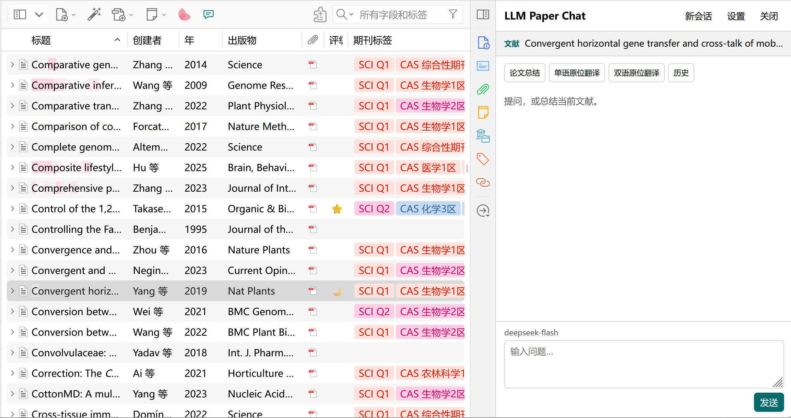
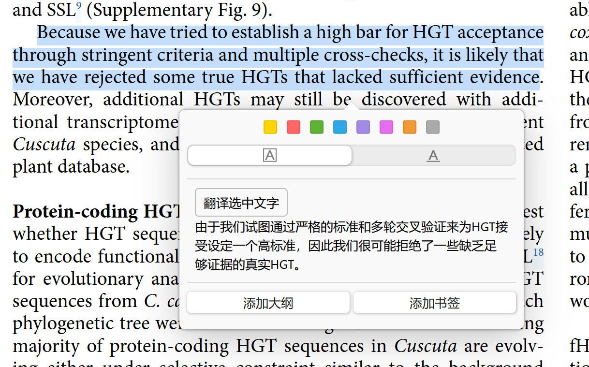
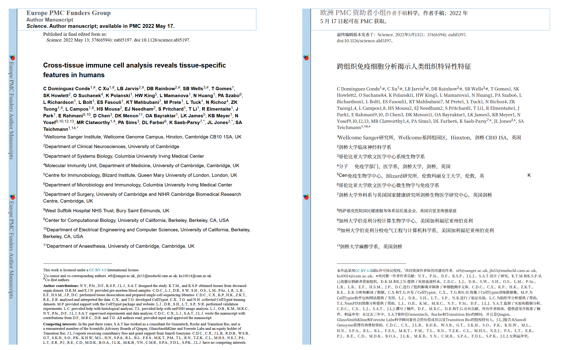
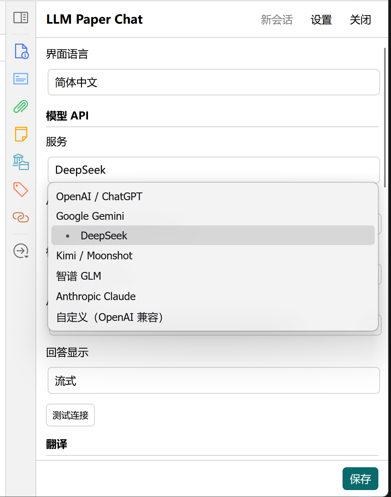

# LLM Paper Chat

[](https://zotero-chinese.com/plugins/)

**Chat with papers, translate PDFs, summarize studies, and write literature reviews in the Zotero 10 sidebar.**

[简体中文](README.md) · [Download](https://github.com/Daaaaxianer/llm-paper-chat/releases/latest) · [Screenshots](#screenshots) · [Report an issue](https://github.com/Daaaaxianer/llm-paper-chat/issues)

## Features

- **AI sidebar chat.** Select a paper and ask about its methods, results, or other details.
- **Selection translation.** Translate selected text in the PDF reader on demand or automatically.
- **Full PDF translation.** Generate a translated PDF that preserves the original layout and attach it to the Zotero item.
- **Bilingual PDFs.** Save a side-by-side PDF with the original and the translation.
- **Paper summaries.** Generate a structured plain-text summary, then copy it or save it as a Zotero note.
- **Literature reviews.** Synthesize findings, limitations, and research gaps across one or more collections.

## Screenshots

### AI sidebar

Ask questions, summarize the selected paper, or start a PDF translation from the sidebar.



### PDF selection translation

The translation appears in the PDF reader popup. The example uses [Yang et al., Nature Plants, 2019](https://doi.org/10.1038/s41477-019-0458-0).



### Bilingual PDF

The English original appears on the left and the Chinese translation on the right. The example translates the author manuscript of [Domínguez Conde et al., Science, 2022](https://doi.org/10.1126/science.abl5197), licensed under [CC BY 4.0](https://creativecommons.org/licenses/by/4.0/).



## Installation and setup

1. Download the `.xpi` from the latest release. In Zotero 10, open **Tools → Plugins → gear menu → Install Plugin From File** and select the file.
2. Click **LLM Paper Chat** in the library toolbar to open the sidebar. Right-click the icon for **New chat** or **Settings**.
3. In **Model API**, select a provider, enter the model ID and API key, and click **Test connection** before saving. The plugin supports OpenAI, Gemini, DeepSeek, Kimi, GLM, Claude, and custom OpenAI-compatible endpoints. You can also change the interface language and translation languages in Settings.

### OpenAI-compatible model setup

Under **Settings → Model API**, select **Custom (OpenAI-compatible)**. Enter the API base URL or the full `/chat/completions` URL. The screenshot shows the provider menu and the connection test button.



## Full PDF translation

Full PDF translation uses a local [BabelDOC](https://github.com/funstory-ai/BabelDOC) executable. Chat, summaries, collection analysis, and selection translation use the configured model API.

With [uv](https://github.com/astral-sh/uv) installed, run these commands to install BabelDOC and find its executable.

```powershell
uv tool install --python 3.11 "BabelDOC==0.7.1"
uv tool dir --bin
```

Under **Settings → Translation**, select `babeldoc.exe` on Windows or `babeldoc` on macOS or Linux. BabelDOC downloads layout models and fonts on its first run.

For English-to-Simplified-Chinese translation, a file named `Paper.pdf` produces `Paper_eng2zh-CN.pdf` or `Paper_eng2zh-CN_dual.pdf`. Results for scans and complex layouts depend on the source PDF and BabelDOC.

## History, notes, and data

- Analysis history stays on the device for 30 days by default. Adjust the retention period or clear it in Settings.
- Zotero manages saved notes according to your Zotero sync settings.
- The selected model provider receives text needed for analysis or translation. API keys are stored in Zotero's password manager.

## Build from source

Run `python build.py` from the repository root. The build uses the Python standard library and writes the XPI and `updates.json` to `dist/`.

## Acknowledgments

- [Zotero](https://github.com/zotero/zotero) provides the desktop extension environment and APIs.
- [BabelDOC](https://github.com/funstory-ai/BabelDOC) is the separate command-line program used for full PDF translation, distributed under [AGPL-3.0](https://github.com/funstory-ai/BabelDOC/blob/main/LICENSE).
- [PDFMathTranslate-next](https://github.com/PDFMathTranslate/PDFMathTranslate-next) informed the layout-preserving PDF translation workflow.
- [Zotero Translator Next](https://github.com/ECHOUniverse/zotero-translator-next) and [zotero-gpt](https://github.com/MuiseDestiny/zotero-gpt) informed the design of selection translation, model setup, and paper chat.
- The README structure draws on [Best README Template](https://github.com/othneildrew/Best-README-Template) and [Awesome README](https://github.com/matiassingers/awesome-readme).
