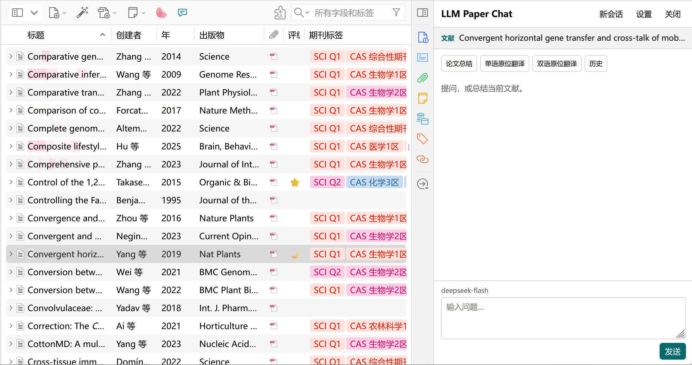
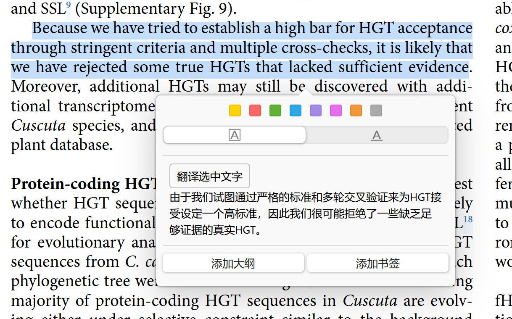
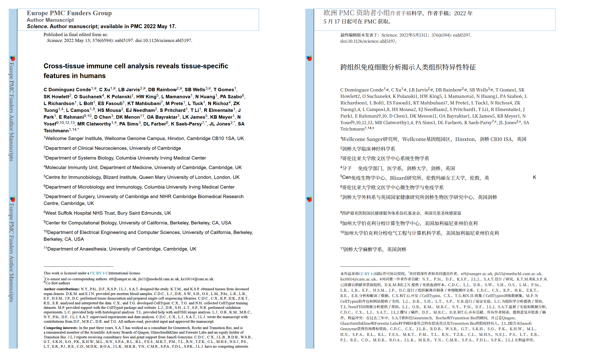
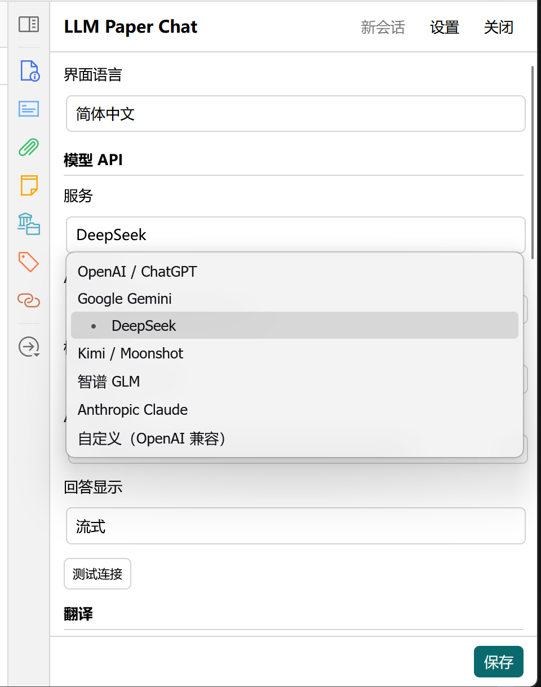

# LLM Paper Chat

**在 Zotero 10 右侧边栏用大语言模型与论文对话、翻译 PDF、总结文献和撰写综述。**

[English](README.en.md) · [下载安装包](https://github.com/Daaaaxianer/llm-paper-chat/releases/latest) · [功能截图](#功能截图) · [反馈问题](https://github.com/Daaaaxianer/llm-paper-chat/issues)

## 功能

- **AI 侧边栏对话**：选中文献，在右侧边栏追问研究方法、结果和细节。
- **划词翻译**：在 PDF 阅读器中选中文字，点击翻译或启用自动翻译。
- **PDF 全文翻译**：保留原版式，生成译文 PDF 并添加为文献附件。
- **PDF 双语翻译**：生成原文与译文对照的 PDF，直接保存到 Zotero。
- **文献总结**：生成结构化纯文本总结，可复制或保存为 Zotero 笔记。
- **文献综述**：按主题综合一个或多个收藏夹中的研究发现、局限与研究空白。

## 功能截图

### AI 侧边栏

选中论文后，在右侧边栏提问、生成总结或发起 PDF 翻译。

### PDF 划词翻译

选中 PDF 中的一段文字，译文直接显示在阅读器弹窗内。示例论文为 [Yang 等，Nature Plants，2019](https://doi.org/10.1038/s41477-019-0458-0)。

### 双语 PDF

左侧为英文原文，右侧为中文译文。示例翻译自 [Domínguez Conde 等，Science，2022](https://doi.org/10.1126/science.abl5197) 的作者手稿，原文采用 [CC BY 4.0](https://creativecommons.org/licenses/by/4.0/)。

## 安装与配置

1. 从发行页下载 `.xpi` 文件，在 Zotero 10 的 **工具 → 插件 → 齿轮 → 从文件安装插件** 中打开。
2. 点击文献列表工具栏上的 **LLM Paper Chat** 图标，打开右侧边窗。右击图标可直接选择 **新会话** 或 **设置**。
3. 在 **模型 API** 中选择服务、填入模型 ID 和 API 密钥，点击 **测试连接** 后保存。支持 OpenAI、Gemini、DeepSeek、Kimi、GLM、Claude 及自定义 OpenAI 兼容接口。

自定义接口可填写 API 根地址或完整的 `/chat/completions` 地址。界面、源语言和目标语言均可在设置中切换。

### OpenAI 兼容模型设置

在 **设置 → 模型 API → 服务** 中选择 **自定义（OpenAI 兼容）**。下图展示了服务选项和「测试连接」按钮的位置。

## 整篇 PDF 翻译

整篇原位翻译调用本机的 [BabelDOC](https://github.com/funstory-ai/BabelDOC)。问答、总结、目录分析和划词翻译只需配置模型接口。

如果已安装 [uv](https://github.com/astral-sh/uv)，可用以下命令安装并查找 BabelDOC。

~~~powershell
uv tool install --python 3.11 "BabelDOC==0.7.1"
uv tool dir --bin
~~~

打开 **设置 → 翻译 → BabelDOC 本机可执行文件**，从命令显示的目录选择 Windows 上的 `babeldoc.exe`，或 macOS、Linux 上的 `babeldoc`。第一次运行时 BabelDOC 会下载排版模型和字体。

选择 **单语原位翻译** 或 **双语原位翻译**。例如将 `Paper.pdf` 英译简中，附件文件名分别为 `Paper_eng2zh-CN.pdf` 和 `Paper_eng2zh-CN_dual.pdf`。复杂版式和扫描件的处理效果取决于 BabelDOC 与源文件。

## 历史、笔记与数据

- **本地历史**可查看和复用已有分析，默认保留 **30 天**，可在设置中调整或清空。
- **Zotero 笔记**按 Zotero 的同步设置管理。
- **模型服务**接收分析或翻译所需的文本。API 密钥保存在 Zotero 的密码存储中。

## 从源码构建

在仓库根目录运行 `python build.py`。构建只使用 Python 标准库，在 `dist/` 中生成 XPI 和对应的更新清单 `updates.json`。

## 开源项目与致谢

- [Zotero](https://github.com/zotero/zotero) 提供桌面插件环境及文献、笔记和 PDF 阅读器接口。
- [BabelDOC](https://github.com/funstory-ai/BabelDOC) 是整篇 PDF 原位翻译所调用的独立开源程序，按其 [AGPL-3.0 许可证](https://github.com/funstory-ai/BabelDOC/blob/main/LICENSE) 分发。安装包通过命令行调用用户本机安装的 BabelDOC。
- [PDFMathTranslate-next](https://github.com/PDFMathTranslate/PDFMathTranslate-next) 为保留版式的单语和双语 PDF 翻译流程提供实现参考。
- [Zotero Translator Next](https://github.com/ECHOUniverse/zotero-translator-next) 和 [zotero-gpt](https://github.com/MuiseDestiny/zotero-gpt) 为划词翻译、模型设置和文献对话的交互设计提供参考。
- README 的结构参考 [Best README Template](https://github.com/othneildrew/Best-README-Template) 和 [Awesome README](https://github.com/matiassingers/awesome-readme)。
